# OneXPlayer3-SteamOS

[简体中文](README.md) | [English](README.en.md) | [安装方法](#3-安装方法)


## 1. 简介

为 ONEXPLAYER 3 掌机提供 SteamOS 支持，适配游戏模式、KDE 桌面、手柄与硬件控制，并支持 Intel XeSS XMX 加速与 XeSS 帧生成（如游戏支持）。

当前 main 分支整合版为 OXP3 SteamOS 1.0.6，目标为 SteamOS 3.10；完整安装包的下载状态见 GitHub [Releases](https://github.com/FlightDan/OneXPlayer3-SteamOS/releases)。同时为使用其他版本 SteamOS 的掌机提供脚本维护工具。

发现问题，请发送邮件至 **[dan@devdan.cc](mailto:dan@devdan.cc)**，或提交 [GitHub Issue](https://github.com/FlightDan/OneXPlayer3-SteamOS/issues)。

<details>
<summary>查看安装器截图</summary>

**安装位置 · 磁盘与分区选择**

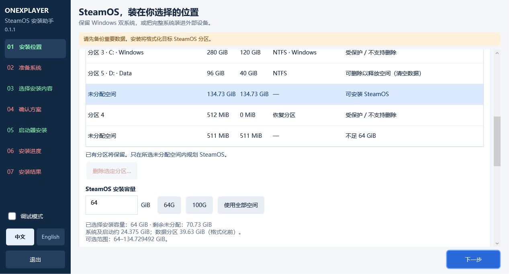

**选择安装内容 · 设备适配与插件**

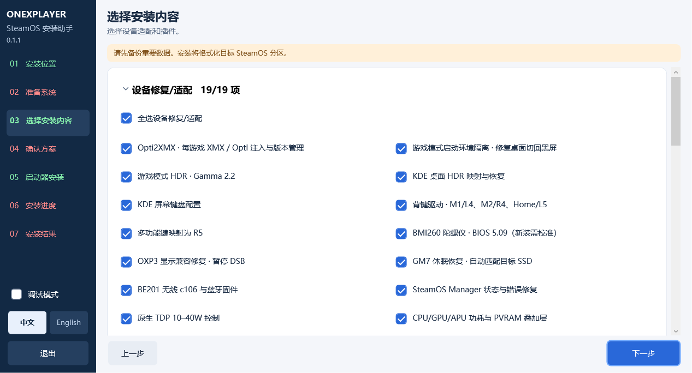

**启动器设置 · rEFInd 双系统菜单**

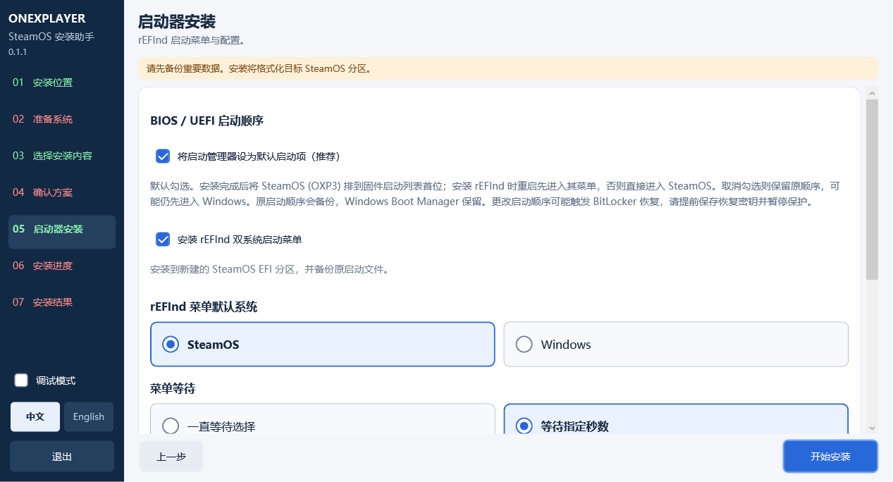

**安装进度 · 写入、读回核对与详细日志**

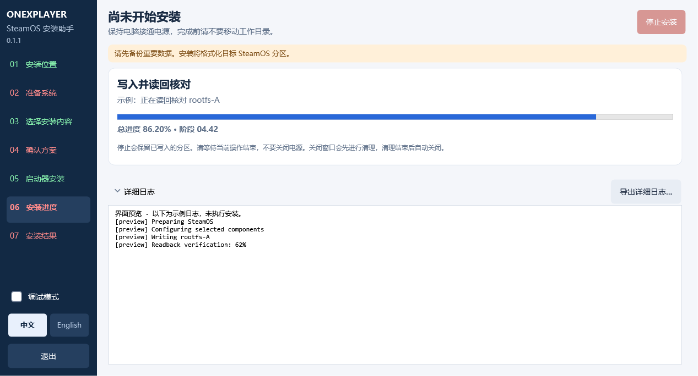

截图来自安装器实际界面；磁盘布局、安装进度及日志为预览示例，未执行安装。

</details>

<details>
<summary>如何正确报告 Bug</summary>

请先查看已有 Issue；一个 Issue 尽量只报告一个问题，并提供以下信息：

- **问题描述**：发生了什么？预期应该怎样？
- **复现步骤**：从启动或打开功能开始，写出能重复触发问题的操作。
- **环境与版本**：ONEXPLAYER 3 型号、BIOS、SteamOS、安装包版本；涉及插件时补充 Decky 和插件版本。
- **游戏相关问题**：游戏名称、Proton 版本、游戏模式或桌面模式，以及 XeSS / XMX / Opti 注入是否开启。
- **发生频率**：每次、偶发，还是仅在重启、休眠唤醒或插拔电源后发生？
- **附件**：相关截图、报错原文和对应时段日志；分享前移除密码、令牌和个人信息。

可以复制这个模板到邮件或 Issue：

```text
问题：
设备 / BIOS：
SteamOS / 安装包版本：
Decky / 插件版本（如适用）：
游戏 / Proton / XeSS设置（如适用）：
复现步骤：
预期结果：
实际结果：
发生频率：
截图 / 日志：
```

</details>

## 2. 适配功能

| 功能 | 适配说明 | 状态 |
| --- | --- | :---: |
| HDR · 游戏模式 / KDE 桌面 | 面板适配的 **1100 / 472 尼特映射** | ✅ |
| 手柄、背键与多功能键 | M1 → L4、Home → L5、M2 → R4、多功能键 → R5，支持 Steam Input 自定义 | ✅ |
| BMI260 陀螺仪 | 游戏内方向与跟随支持；要求 BIOS 5.09，新安装需校准 | ✅ |
| Intel XeSS / XMX | 兼容游戏中的原生 XeSS XMX 加速 | ✅ |
| 刷新率 / VRR | 内屏 30–144 Hz 适配 | ✅ |
| 原生 TDP | Steam 性能菜单 **10–40 W** 调节 | ✅ |
| OXP3 Fan | 固件自动模式与自定义风扇曲线 | ✅ |
| OXP3 CPU | EPP、核心分组限频、PL1 10–40 W 与独立 PL2（最高 80 W）；PL1 联动 Steam 原生 TDP | ✅ |
| [OXP3 Light](windows-installer/components/light/README.md) | 摇杆灯环、Xbox 按钮与背部标语灯的开关、纯色及亮度控制；不自动恢复开机或休眠后的灯光设置 | ✅ |
| Split-lock 修复 | 减少 split-lock 报告洪泛，重启生效；不自动清理历史报告 | ✅ |
| 性能覆盖层 | CPU / GPU / APU 功耗、风扇与显存信息已正确显示 | ✅ |
| 音量按键 | 音量按键正常 | ✅ |
| Waydroid | Android 应用与游戏模式入口；未充分验证 | 🧪 |
| 重启进入 Windows | [Decky 按钮与桌面快捷方式](windows-installer/docs/WINDOWS_REBOOT.md)，仅下一次启动生效；用户实机重启进入 Windows 已通过 | ✅ |
| OXP3 Battery | 旁通供电与正确的充电上限控制，已验证 | ✅ |
| BE201 Wi-Fi | 无线固件适配；有大量用户报告 Windows 下硬件故障，如果掉驱动请尝试重启 | ⚠️ |
| 双系统启动器 · rEFInd | Windows / SteamOS 启动菜单；启动阶段十字键与 A/B 已可用 | ✅ |

✅ 表示已提供对应适配；🧪 表示仍在验证；⚠️ 表示存在已知问题。HDR 使用 Gamma 2.2 映射路径，1100 / 472 为映射参数。新安装、更新、重启及休眠后的支持情况以对应 Release 说明为准。

<details>
<summary>查看 HDR、原生 TDP 与性能覆盖层截图</summary>

**游戏模式 HDR**

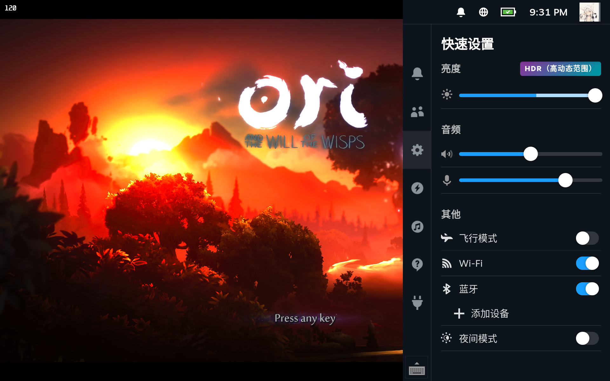

**原生 TDP · 40 W**

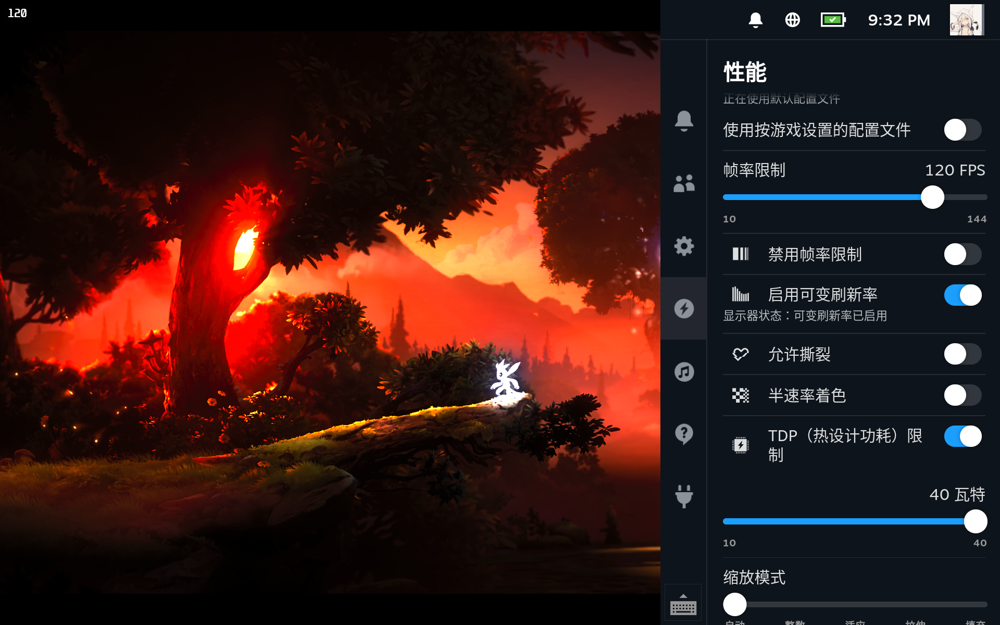

**游戏中的 TDP 与性能覆盖层**

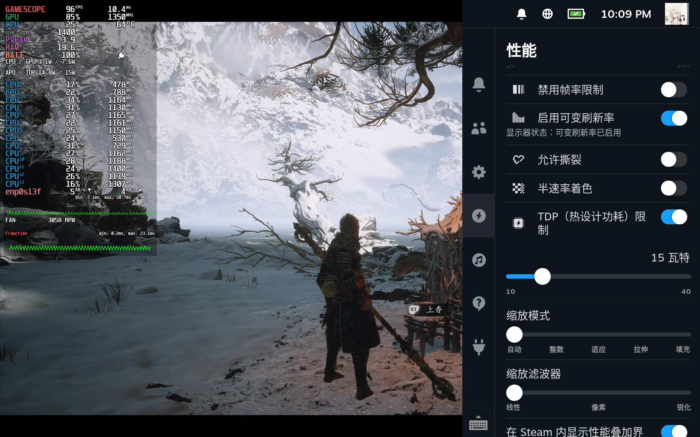


</details>

<details>
<summary>查看 OXP3 控制插件截图</summary>

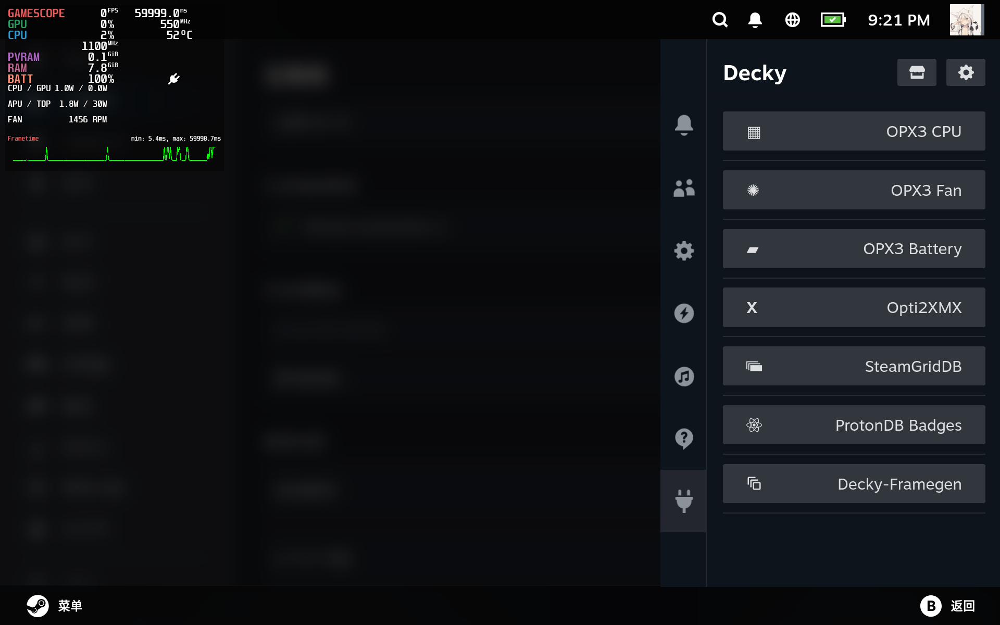

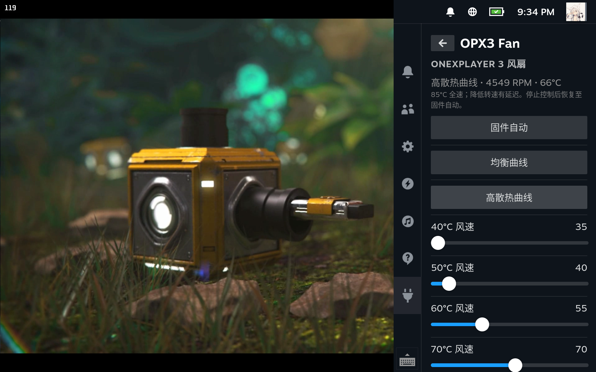

</details>

<details>
<summary>查看 Waydroid 截图</summary>

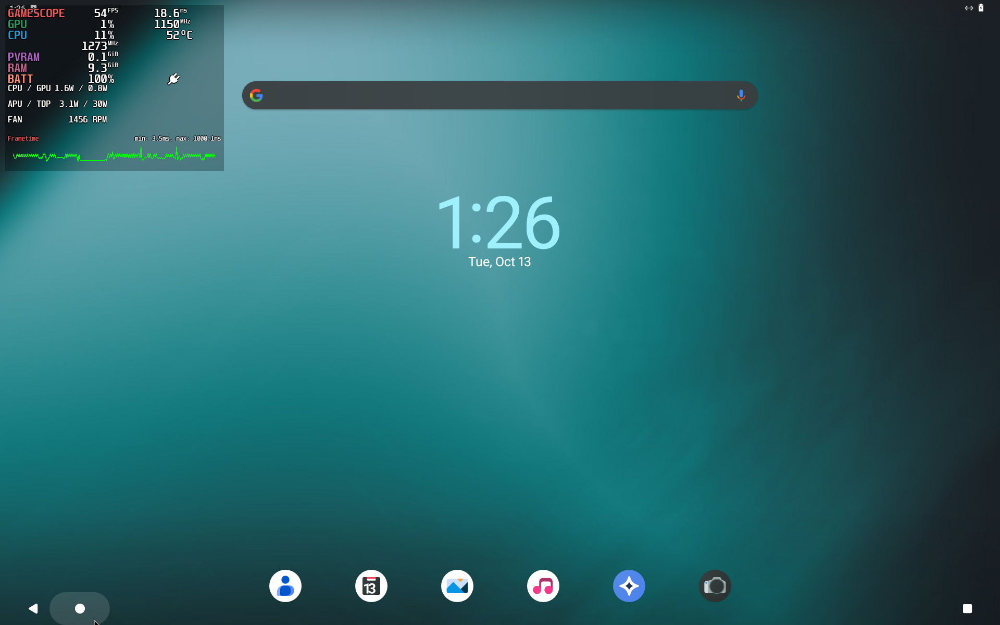

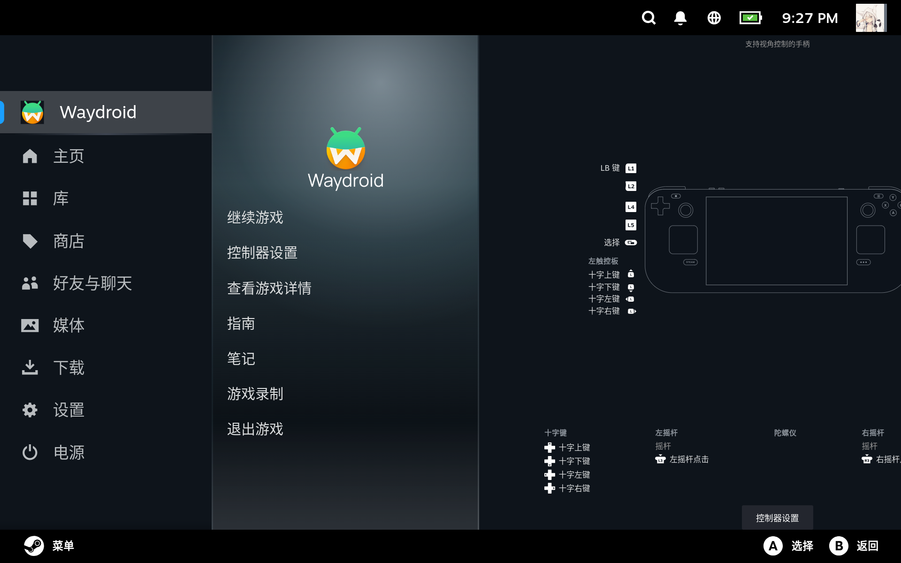

</details>

<details>
<summary>查看双系统启动器截图</summary>

Windows / SteamOS 启动菜单截图。启动阶段十字键与 A/B 已可用。

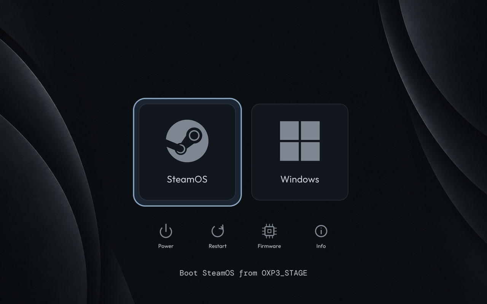

</details>

## 3. 安装方法

### 在 Windows 中使用安装器安装双系统

完整 Windows x64 安装应用 ZIP 通过 [Releases](https://github.com/FlightDan/OneXPlayer3-SteamOS/releases) 提供。当前 main 分支整合版为 **1.0.6 stable**；使用前请阅读 [1.0.6 发布说明](windows-installer/docs/RELEASE_1.0.6.md)。

1. 从 Releases 下载 Windows 安装应用 ZIP，完整解压并保留同目录文件。
2. 备份现有数据；如启用 BitLocker / 设备加密，保存并确认恢复密钥可用，暂停保护后进入 BIOS / UEFI 关闭安全启动（Secure Boot）。安装后确认 Windows 正常启动，再恢复保护。
3. 为目标 GPT 磁盘准备至少 **64 GiB 连续未分配空间**，并为 Windows 中的系统准备工作空间预留至少 **45 GiB** 可用空间，建议 **64 GiB**。
4. 双击 **`SteamOSInstaller.exe`**，按向导选择安装位置、官方系统镜像及需要的适配组件；选择安装内容后直接进入“确认方案”。共享分区挂载功能暂时隐藏，新安装不提供挂载选择。支持内置硬盘双系统安装；外部 SD / SSD 的验证范围见实现状态。
5. 核对目标磁盘、分区方案与安装选项，可按需启用 rEFInd 启动菜单，确认后开始安装。
6. 安装完成后，按应用提示启动 SteamOS，并检查游戏模式、桌面、按键和插件。

安装包不含系统镜像，准备 SteamOS 3.10 及部分组件初始化需要联网。完整步骤见[安装指南](windows-installer/docs/INSTALLATION_GUIDE.md)。

1.0.6 提供本项目的 OXP3 控制插件与 Opti2XMX；第三方 Decky 插件由用户自行安装。新镜像内置“OXP3 修复与项目更新”桌面及应用菜单入口。

### 在 SteamOS 中更新本项目或安装修复

[OXP3 修复与项目更新工具](steamos-maintenance/README.md)，供已安装 SteamOS 的用户选择修复、插件及后续项目更新。使用 GTK 原生触屏窗口，维护当前槽位，提供签名包验证、回退及中断恢复。

在 SteamOS 的 KDE 桌面模式打开终端，以普通桌面用户运行以下命令（不要加 `sudo`）。首次使用请按[维护工具文档](steamos-maintenance/README.md)核对发行公钥指纹：

```bash
curl --fail --location --proto '=https' --proto-redir '=https' \
  --output install-oxp3-maintenance.sh \
  https://github.com/FlightDan/OneXPlayer3-SteamOS/releases/download/maintenance-v1.0.6%2Bmaintenance.13/install-oxp3-maintenance.sh \
  && bash install-oxp3-maintenance.sh
```

按窗口提示选择需要的修复或插件，所需组件会按选择下载。1.0.6 提供正式签名维护包与 Bash 安装入口；使用说明见[维护工具文档](steamos-maintenance/README.md)，已测范围与待测项见[验证记录](steamos-maintenance/VALIDATION.md)。

维护工具面向 ONEXPLAYER 3，按组件检查兼容性。原生驱动、HDR、Decky 与插件运行库仍要求 SteamOS 3.10 / build 20260924.1000 / 内核 7.2.4；其他 SteamOS 版本目前提供屏幕键盘、Flathub 等已适配设置，不兼容项会显示原因。

这里的更新只针对本项目；不升级 SteamOS，也不改变官方系统更新设置。

## 4. 独家插件 · Opti2XMX

**[Opti2XMX](https://github.com/FlightDan/Opti2XMX)** 是为这套适配开发的 Decky 插件，可为兼容的游戏直接提供原生的 **XeSS XMX 加速与 XeSS 帧生成**，并为其他兼容游戏提供支持 **XeSS 帧生成的 OptiScaler**。

1.0.6 整合 Opti2XMX **0.2.8**；其 XeSS FG 2x / 3x / 4x 控件仍标为实验性，兼容性与测试范围见[帧生成说明](windows-installer/components/opti2xmx/docs/FRAME_GENERATION.md)。

- 原生 XeSS 游戏可直接配置 XMX；其他兼容游戏可通过 OptiScaler 接入。
- XMX 加速与 Opti 注入独立开关，支持安装、版本切换、回退和卸载。
- 提供超分、帧生成输出及相关设置，支持中英文界面。

XMX 需要兼容的 Intel 硬件及配套运行环境；仅安装插件不足以启用。帧生成支持取决于游戏、驱动与 Proton。测试游戏原生 XeSS 帧生成时，应关闭 Opti 注入。

<details>
<summary>查看 Opti2XMX 与原生 XeSS 游戏截图</summary>

**Opti2XMX · 按游戏开启 XMX**

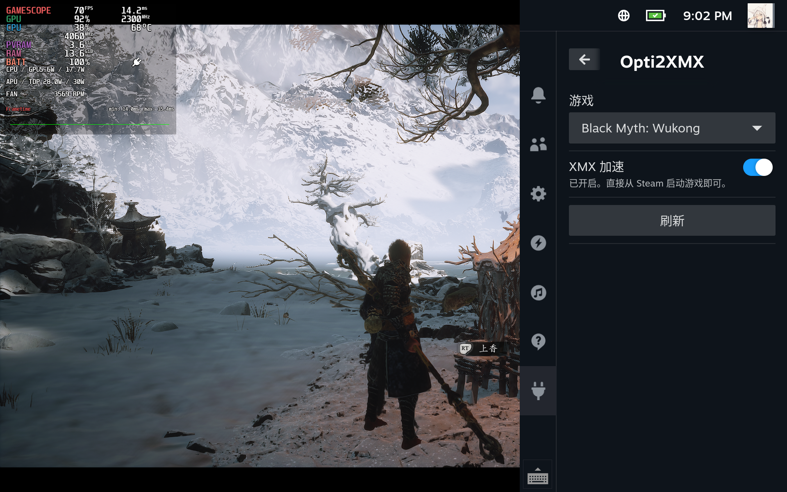

**《黑神话：悟空》原生 XeSS 与帧生成设置**

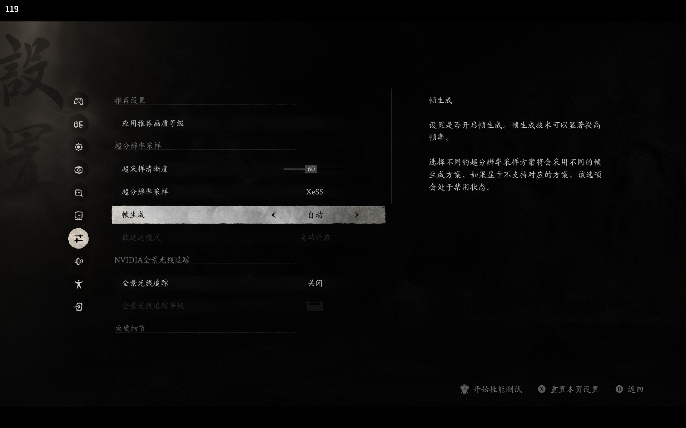

**游戏画面**

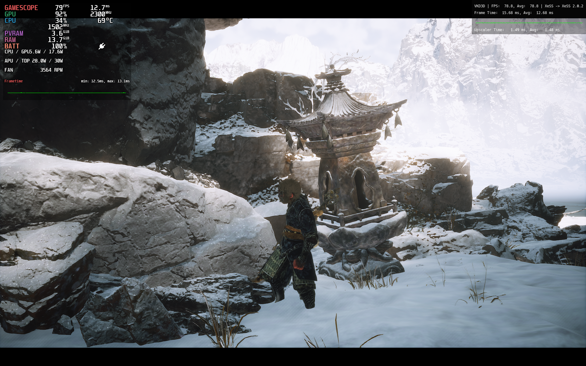

</details>

## 5. Roadmap

- [ ] G3E 开关核控制
- [x] 触屏友好安装器 UI / UX
- [x] 内置启动管理器：Windows / SteamOS 启动选择与默认启动项管理
- [ ] 免构建 64G 系统镜像及配套安装器

更多后续工作见 [Roadmap](ROADMAP.md)。

## 6. 更新验证与密钥安全

客户端使用固定的 Ed25519 发行公钥验证更新目录和清单的签名，再核对下载文件的 SHA-256 摘要。签名错误、文件摘要不一致或更新试图替换已固定公钥时，拒绝继续安装。

发行公钥公开提供：[公钥文件](steamos-maintenance/trusted-public-key.pem)及[完整指纹](steamos-maintenance/docs/PUBLISHER.md#已建立的身份)。首次安装时，请从可信项目来源核对公钥及其完整指纹。

按现有发布工具的设计，私钥由发布者在本地保管，使用 Windows 当前用户 DPAPI 加密及受限文件权限保护，仅允许当前用户和 SYSTEM 访问，不随源码或更新包分发。

## 7. 许可证

Copyright © 2026 FlightDan and contributors.

除另有说明外，本仓库的原创代码与文档采用 **GNU Affero General Public License v3.0（`AGPL-3.0-only`）**，完整条款见 [LICENSE](LICENSE)。

第三方代码、组件、固件和系统镜像保留各自的版权与许可证。Opti2XMX 当前同样采用 `AGPL-3.0-only`，其使用的 Decky 模板保留原 BSD-3-Clause 声明。详见 [第三方声明](THIRD_PARTY_NOTICES.md)。

本项目为社区维护的非官方项目，与 Valve、Intel 或 ONEXPLAYER 无官方隶属关系；相关商标归各自权利人所有。

## 8. 致谢

感谢以下项目及其贡献者：

特别感谢 **HANA** 提供的原始设备适配项目 **[onexplayer3-steamos-setup](https://github.com/HHHHanasak1/onexplayer3-steamos-setup)**，以及提供设备、日志和实机反馈的测试者。

- **设备适配**：[InputPlumber](https://github.com/ShadowBlip/InputPlumber)、[Linux](https://kernel.org/)、[KDE / KWin](https://invent.kde.org/plasma/kwin)、[Gamescope](https://github.com/ValveSoftware/gamescope)、[SteamOS Manager](https://gitlab.steamos.cloud/holo/steamos-manager)、[MangoHud](https://github.com/flightlessmango/MangoHud)。
- **XeSS 支持**：[Intel XeSS](https://github.com/intel/xess)、[xess-xmx-linux](https://github.com/HHHHanasak1/xess-xmx-linux)、[OptiScaler](https://github.com/optiscaler/OptiScaler) 及 [XeSS 配套运行环境](THIRD_PARTY_NOTICES.md)。
- **插件框架**：[Decky Loader](https://github.com/SteamDeckHomebrew/decky-loader)。
- **Android 支持**：[Waydroid](https://github.com/waydroid/waydroid)（[SteamOS 集成](https://github.com/pjohno/steamos-waydroid-bundle)）。
- **双系统启动**：[rEFInd](https://www.rodsbooks.com/refind/)、[UsbXbox360Dxe](https://github.com/jlobue10/UsbXbox360Dxe)。

各第三方项目的来源、用途与许可范围详见 [THIRD_PARTY_NOTICES.md](THIRD_PARTY_NOTICES.md)。
