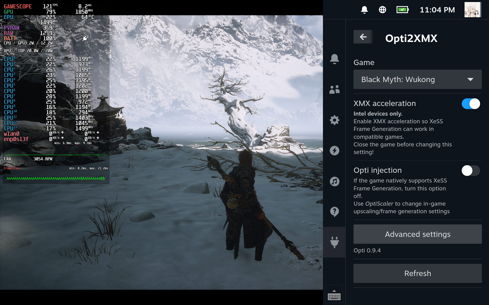
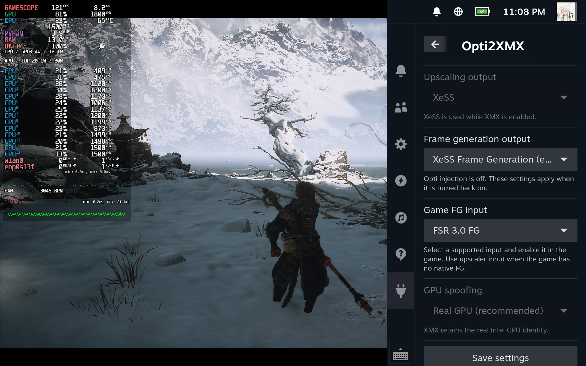

# Opti2XMX

[English](README.md) | [简体中文](README.zh-CN.md)

**在 SteamOS 上按游戏管理 OptiScaler 和 Intel XeSS XMX 的 Decky 插件。**

版本 **0.2.6** · AGPL-3.0-only 许可证

本次发布新增实验性 XeSS FG 2x/3x/4x 请求、独立设置撤销，以及防止 Proton 覆盖的 XMX shim 路径。已在一台 Intel 掌机完成赛博朋克 2077 短时基准与回滚测试，FG 控件继续保留实验性标记。见[帧生成测试与恢复说明](docs/FRAME_GENERATION.md)。

## 功能

- 安装 OptiScaler 0.9.4 / 0.7.9，迁移可识别的已有安装，支持回退。
- 独立的“下载并配置 XMX 运行环境”按钮，显示体积、下载进度、阶段和结果。插件 ZIP 保持小体积；没有 XMX 运行环境也能管理 OptiScaler。
- 为兼容的 Intel 设备按游戏开启或恢复 XMX 配置。
- 独立开关 Opti 注入，保留 XMX 设置和备份。
- 设置超分、帧生成输出和显卡身份，打开 Opti 面板。
- 请求实验性 Opti XeSS FG 2x/3x/4x 输出，支持独立设置撤销和中断恢复。
- 中英文界面，跟随 Steam 语言。
- 下载进度显示实际字节数、已知总量，以及解压／安装阶段；总量未知时不显示百分比。忙碌和错误提示持续可见。

关闭面板不会取消后台安装，重开后会重新连接当前任务；待确认启动设置仍可继续或恢复。只读进度查询五秒超时后保留最后快照并提示重试，安装命令不会自动重试。

本项目为独立、非官方项目，与 Intel、Valve、Decky 和 OptiScaler 无隶属关系。

## 截图

主界面（英文界面）：



高级设置（英文界面）：



赛博朋克 2077 2.31 实际内置基准：请求 XeSS FG 4x、光追关闭，显示 OptiScaler 英文性能 OSD：


以上为实际游戏画面。仅凭 OSD 不能确认实际倍率或屏幕扫描帧率，另见[验证证据与边界](docs/FRAME_GENERATION.md)。

## 使用条件

- Linux / SteamOS 原生 Steam、Decky Loader，以及至少运行过一次的 Proton 游戏。
- XMX 需要兼容的 Intel 硬件，以及独立的 XMX 运行库、修改版 ANV 和编译器环境。可点击按钮从 GitHub 下载固定版本运行环境（186.5 MiB），也能使用已准备的运行环境。参见[运行环境说明](docs/RUNTIME.md)。
- Opti 解压需要系统 `7z`；打开面板需要 `xdotool`。XMX 检查还会使用 `bash`、`ldd` 和 `vulkaninfo`。

XMX 路线在 Intel ONEXPLAYER 3 上开发。AMD Steam Deck 不具备 Intel XMX 加速能力。目前未完成广泛设备、游戏兼容性验证，也未获得 Decky 商店收录。

## 安装

从 [Releases 页面](https://github.com/FlightDan/Opti2XMX/releases/tag/v0.2.6)下载 `opti2xmx-0.2.6.zip`，也可按下方步骤构建 ZIP。
进入 Decky 设置，启用开发者模式，使用 **Install Plugin from ZIP File / 从 ZIP 文件安装插件**（名称可能随 Loader 版本变化），选择安装包后打开 Opti2XMX。

插件以 Steam 用户身份运行，加载插件本身不会修改游戏。安装包不包含上游 DLL、私有运行库二进制、游戏文件或生成的编译缓存。

## 使用

1. 退出游戏，在 Opti2XMX 中选择游戏。
2. 游戏没有原生 XeSS 时，安装 OptiScaler 或迁移可识别的 Opti 安装；原生 XeSS 游戏可直接走 XMX 路线。
3. 如需 XMX，点击 **下载并配置 XMX 运行环境**（下载 195.6 MB），或另行准备。就绪后开启 **XMX 加速**，插件会写入并读回确认 Steam 启动项。
4. 使用 **Opti 注入**开关控制已管理的注入器。测试游戏原生 XeSS 帧生成时，先关闭 Opti 注入。
5. 更改后重新启动游戏。高级设置提供超分／帧生成输出、显卡身份、版本选择、回退和卸载。

安装、更换版本、回退或卸载 Opti 前需要关闭 XMX；更换版本还需要开启 Opti 注入。不要让其他注入管理工具覆盖本插件正在管理的安装。

## 限制与恢复

XMX 依赖兼容的 XeSS 接口，本插件不是全局 Gamescope 超分。FSR1 和任意自定义超分不自动兼容。帧生成仍取决于游戏、运行库、驱动和 Proton。OptiScaler 0.9.4 提供 XeFG 输出，但没有实现 XeFG 输入。安装成功不代表已经执行 XMX，也不代表画质或性能提升。

XMX 记录保存在 `~/.local/share/opti2xmx/games/<appid>/`，Opti 备份保存在 `~/.local/share/opti2xmx/opti/<appid>/`。未完成操作可继续或回退；DLL 被其他工具修改时会阻止恢复，避免覆盖。卸载 Decky 插件**不会**恢复游戏或删除备份，请先退出游戏并在插件内完成恢复。

设置撤销保留每个受管理文件各自的原始内容。OptiScaler 自动保存产生的纯 INI 格式变化，会在严格确认选项名称、值和 DEFAULT 归属一致后归档并接受；歧义语法、真实值变化和备份副本变化仍会阻止恢复。新建 XMX 配置使用独立的前缀 shim 路径，避免 Proton 替换 DriverStore 副本；已有配置需先恢复再开启，才能使用新路径。

默认从官方 GitHub Release 下载 Opti。可选第三方镜像 `ghfast.top`、`gh-proxy.com` 仅接收公开下载地址，不接收账号凭据；镜像的可用性和内容不受本项目控制。

## 构建与测试

需要 Node.js 20+、pnpm 9、Python 3.10+。后端测试需在 Linux 普通用户下运行，不能使用 root。

```sh
pnpm install --frozen-lockfile
pnpm typecheck
pnpm build
node test_frontend.mjs
python3 -B -m unittest discover -v
python3 package_plugin.py
```

输出为 `opti2xmx-0.2.6.zip`，包含 Python 后端、构建后的前端、固定运行环境描述、文档和许可证，不含运行库 DLL 和驱动；仓库中的截图不放入安装 ZIP，保持小体积。测试夹具覆盖恢复、中断、运行环境校验／解压失败和文件冲突，不能替代真实游戏和硬件测试。上方插件截图为之前的 0.2.2 界面。

## 开发与致谢

本项目使用 AI 辅助开发。贡献代码需要人工审阅和目标设备测试。报告问题时请提供插件／Decky／SteamOS 版本、显卡、游戏、Proton 版本及复现步骤；分享日志前移除个人路径和账号信息。

基于 [Decky](https://github.com/SteamDeckHomebrew/decky-loader)，使用 [OptiScaler](https://github.com/optiscaler/OptiScaler) 和另行配置的 [xess-xmx-linux](https://github.com/HHHHanasak1/xess-xmx-linux)。参见[第三方说明](THIRD_PARTY_NOTICES.md)。
