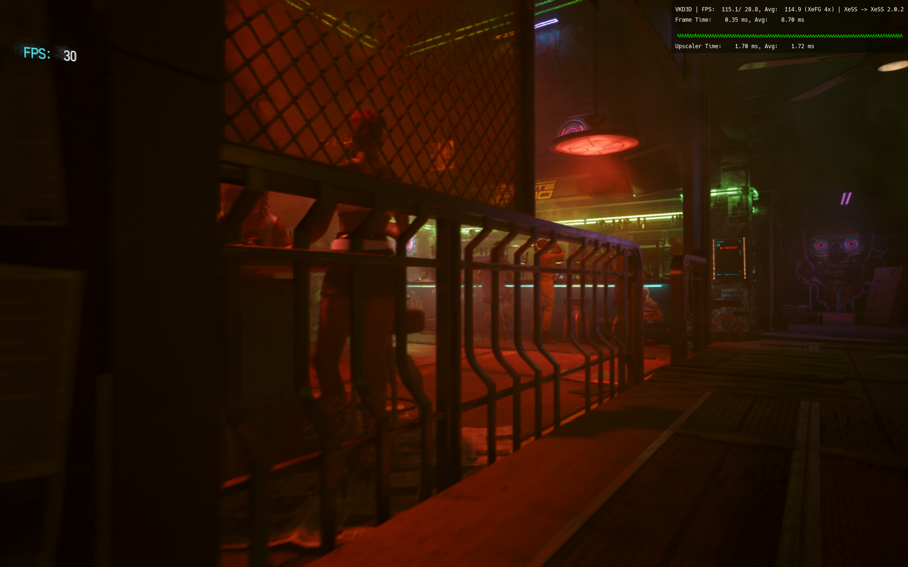
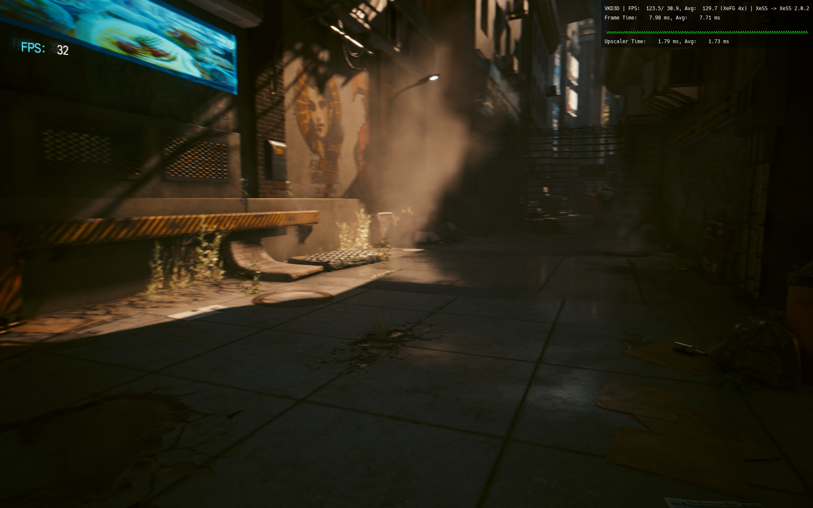
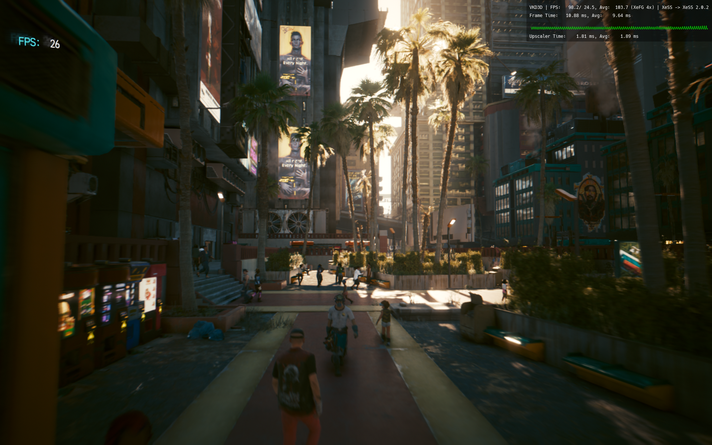

# Experimental XeSS frame generation / 实验性 XeSS 帧生成

This build adds **requested 2x/3x/4x multipliers for OptiScaler's XeSS FG output**. It does not turn every XeSS-SR game into a frame-generation game. Native XeSS FG remains controlled by the game; selecting Native in the plugin relinquishes Opti's FG interception and does not disable the game's own FG.

本构建为 **OptiScaler 的 XeSS FG 输出**增加 **2x/3x/4x 请求倍率**。仅支持 XeSS 超分的游戏不会因此自动获得帧生成。原生 XeSS FG 仍由游戏控制；插件选择“游戏原生（不接管）”表示关闭 Opti 的 FG 接管，不会关闭游戏自己的 FG。

## Use / 使用

Exit the game. Use managed OptiScaler 0.9.4, choose **XeSS Frame Generation (experimental)** in Advanced settings, choose the multiplier and the actual supported FG input, then save and restart. For a supported upscaler input without native FG, select the existing upscaler-input route. XeFG input itself is not implemented by OptiScaler 0.9.4. XMX requires compatible Intel hardware and the separate runtime. Keep its self-test and failure fallback enabled.

退出游戏，使用已管理的 OptiScaler 0.9.4，在高级设置选择 **XeSS 帧生成（实验）**、倍率和游戏实际支持的输入，保存后重启。无原生 FG 时，可在受支持的游戏中尝试既有“超分输入”路线；OptiScaler 0.9.4 本身尚未实现 XeFG 输入。XMX 仍需要兼容的 Intel 硬件和独立运行环境，不绕过自检或失败回退。

The four-notch slider offers **Game controlled / 2x / 3x / 4x**. Game controlled disables Opti FG interception; the other notches select XeSS FG output and `[XeFG] InterpolationCount=1/2/3`. Save settings after changing the slider. The runtime can reject or limit the request. A saved setting, loaded DLL, or FPS overlay alone does not establish the effective multiplier. New Opti installations and version changes return to game-controlled FG.

四档滑块依次为 **游戏原生控制／2x／3x／4x**。最左档关闭 Opti 的 FG 接管；其余档位选择 XeSS FG 输出，并将 `[XeFG] InterpolationCount` 设为 1／2／3。调整后点击“保存设置”。运行时可能拒绝或限制倍率；设置保存、DLL 加载或 FPS 叠加层均不能单独证明实际倍率。新安装和更换 Opti 版本后均回到游戏控制。

## Recovery / 恢复

**Undo last settings change** restores the last saved settings snapshot and its owned mirrors. It is separate from **Undo last operation**, which retains the existing install/migration/uninstall rollback. Interrupted settings writes expose **Recover interrupted settings** and block other configuration changes until recovery succeeds. Exit the game first. External changes or symbolic links cause recovery to stop and retain evidence rather than overwrite them.

**撤销上次设置**恢复上次保存前的配置及其受管理副本，与原有安装／迁移／卸载的 **回退上次操作** 独立。设置写入中断后显示 **恢复中断的设置**，恢复完成前阻止其他配置修改。需要先退出游戏；文件被外部修改或替换成符号链接时停止恢复并保留现场。

OptiScaler can rewrite INI spacing when saving. A live INI with exactly the same strictly parsed option names, values and DEFAULT placement is accepted after its complete reformatted bytes are archived. Owned mirrors still require exact bytes. Changed values, ambiguous/duplicate names and invalid syntax remain conflicts.

OptiScaler 自动保存会重排 INI 空格。实时 INI 的选项名称、值及 DEFAULT 归属经严格解析完全相同时，先归档重排后的完整原件再恢复；受管理副本仍按字节校验。真正的选项变化、歧义／重复名称和无效语法仍拒绝覆盖。

New XMX installs place the shim in `C:\opti2xmx-driver` and select it using `INTC_ALT_DRIVER_EXTENSIONS_PATH`. This avoids current Proton Experimental replacing its DriverStore copy on every launch. Shared Proton and system Mesa remain untouched. Existing journals retain their recorded paths; to adopt the new location, restore XMX and then enable it again. Restore before removing the plugin; uninstalling Decky plugins does not restore games.

新 XMX 配置把 shim 放在 `C:\opti2xmx-driver`，通过上述 Intel 扩展路径变量选择它，避免当前 Proton Experimental 每次启动刷新 DriverStore 副本。共享 Proton 和系统 Mesa 不变。旧记录仍按其原路径恢复；先关闭 XMX，再重新开启，才能采用新路径。删除插件前先恢复游戏，卸载 Decky 插件不会自动恢复游戏。

## Evidence and limits / 验证与边界

On 2026-10-16, Arc B390, SteamOS kernel 7.2.4, Proton Experimental 11.0-20261008 and the existing patched Mesa 26.1.2 runtime completed two passes of off/2x/3x/4x in an instrumented official Intel XeSS v3.0.2 DX12 sample, 45 seconds each at a 30-base-FPS target and 1280×720. Each steady sample after a two-second warmup simultaneously reported successful status, the expected enabled flag, successful interpolation and 1/2/3/4 frames sent for presentation. All eight runs exited normally. Enabled runs reported the expected first-frame insufficient-history warning; no later FG errors occurred. Warm runs reused the compiled kernels. Captured sample images were inspected for obvious corruption.

2026-10-16 在上述 B390 / SteamOS / Proton / 运行库组合中，修改 MIT 样例源码加入统计，保持 Intel SDK DLL 原样；完成两轮关闭／2x／3x／4x，每组 45 秒、1280×720、基础帧目标 30 FPS。剔除前 2 秒后，所有逐帧记录同时符合查询成功、实际启用状态、插帧成功及发送呈现帧数 1／2／3／4。八组均正常退出；开启 FG 的组仅首帧出现历史不足提示，后续没有 FG 错误，热启动复用内核，截图未见明显损坏。

These SDK runs alone do not establish game compatibility or long-duration stability. They do not measure physical display scanout, input latency or image-quality superiority. The Opti settings/undo path is covered by Linux fault and lifecycle tests. All controls retain the experimental label.

上述样例单独不能证明游戏兼容或长时间稳定性，没有测量屏幕实际扫描帧率、输入延迟或画质优势。Opti 设置／撤销通过 Linux 故障和生命周期测试，所有控制保留实验性标记。

### Cyberpunk 2077 2.31 / 赛博朋克 2077 2.31

The same handheld, with Proton Experimental 11.0-20261014, OptiScaler 0.9.4 and the existing patched runtime, completed off/2x/3x/4x built-in benchmarks at 1920×1200 with XeSS SR, native game FG off and **ray tracing off**, approximately 64 seconds each. A temporary public-API observer confirmed all steady successful FG states after two seconds: 2459 samples at 2 frames, 2269 at 3 and 2184 at 4. These SDK status windows were approximately 73 seconds and include time outside the benchmark. Initial history/enable transitions were retained separately. Game benchmark FPS counts base rendering and is not physical output FPS.

同一掌机使用上述较新 Proton、OptiScaler 0.9.4 和既有运行库，在 1920×1200、XeSS SR、游戏原生 FG 关闭、**光追关闭**时完成关闭／2x／3x／4x 内置基准，每档约 64 秒。临时公开 API 观察器在剔除前 2 秒后，分别记录 2459／2269／2184 个成功状态，实际发送 2／3／4 帧；状态观测窗口约 73 秒，包含基准之外的时间。初始历史不足和启停切换保留在原始证据中。游戏基准 FPS 是基础渲染计数，不是屏幕输出帧率。

Settings undo, XMX restore and Opti rollback were exercised after the matrix, including an additional 4x run without the temporary observer. The observer is a testing aid and is not included in the plugin or optional runtime.

矩阵后完成设置撤销、XMX 恢复和 Opti 回退，并补跑一次移除临时观察器后的 4x 基准。观察器仅用于测试，不包含在插件或可选运行库中。

**Ray tracing has limited, mixed evidence.** An initial stock Ray Tracing Ultra benchmark with FSR2 Auto and native FG off completed once (64.29 seconds, 28.45 base FPS). Two later Ultra trials encountered GPU timeouts and engine resets; one with actual XeSS SR and FG off reported `VK_ERROR_DEVICE_LOST`. These intermittent failures do not establish that Ultra always crashes or identify SR, the shim, ray tracing or Proton as the cause.

**光追证据有限且结果不一致。** 最初原版游戏使用 FSR2 Auto、原生 FG 关闭时，光追超级基准曾完成一次（64.29 秒、基础帧率 28.45 FPS）。后续两次超级配置测试出现 GPU 超时和引擎复位，其中真正启用 XeSS SR、FG 关闭的一次报告 `VK_ERROR_DEVICE_LOST`。这属于间歇性失败，不能说超级配置必然崩溃，也未能定位为 SR、shim、光追或 Proton 的问题。

A separate stock check with **only ray-traced local shadows enabled**, FSR2 Auto, native FG off and 1920×1200 completed normally: 73.89 seconds, 1214 base frames, 16.43 average base FPS, with no GPU errors found in the captured interval. Reflections, sun shadows, ray-traced lighting and path tracing were off; the configuration was restored byte-for-byte afterward. This establishes one completed light-RT benchmark, not smooth gameplay, long-term stability or ray-traced XeSS FG compatibility. Other games, long sessions, HDR, suspend/resume and native game multipliers remain unverified.

另一次独立原版测试仅开启**光追局部阴影**，使用 FSR2 Auto、原生 FG 关闭、1920×1200，正常完成 73.89 秒基准：1214 个基础帧、平均基础帧率 16.43 FPS，采集时间段内未发现 GPU 错误。反射、太阳阴影、光追照明和路径追踪均关闭，之后配置逐字节恢复。这仅证明一次轻量光追基准完成，不表示游玩流畅、长期稳定或光追与 XeSS FG 的组合已验证。其他游戏、长时间游玩、HDR、休眠恢复和游戏原生倍率仍未验证。

### Actual game captures / 实际游戏截图

Cyberpunk 2077 2.31, requested XeSS FG 4x, 1920×1200, ray tracing off, with OptiScaler's English performance OSD. Screenshots show rendered game scenes; the OSD is not a measurement of physical screen scanout or independent proof of the multiplier.

赛博朋克 2077 2.31，请求 XeSS FG 4x，1920×1200、光追关闭，使用 OptiScaler 英文性能 OSD。截图展示实际渲染场景，OSD 不代表屏幕扫描帧率，也不能独立证明实际倍率。

Sources: [Intel FG guide](https://github.com/intel/xess/blob/v3.0.2/doc/xess_fg_developer_guide_english.md), [OptiScaler 0.9.4 configuration](https://github.com/optiscaler/OptiScaler/blob/v0.9.4/OptiScaler.ini), [OptiScaler XeFG runtime](https://github.com/optiscaler/OptiScaler/blob/v0.9.4/OptiScaler/framegen/xefg/XeFG_Dx12.cpp).
