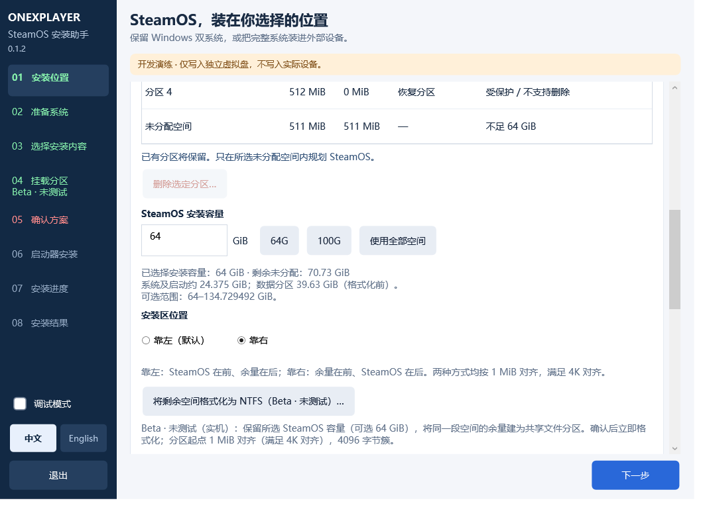
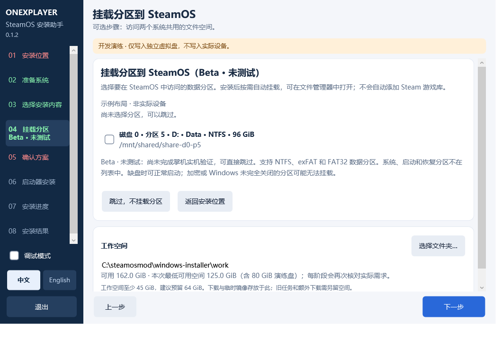

# OXP3 SteamOS 0.1.2

发布日期：2026-10-15。项目整合版渠道为 **stable**，默认系统目标仍为 **SteamOS 3.10 / build 20260924.1000**。本版的剩余空间 NTFS 格式化和共享分区挂载均为 **Beta · 未测试（实机）**；stable 渠道标签不代表这两项功能已完成设备验收。

## 本版变更

- **大偏移量修复**：回归发现 PowerShell 在已有分区末端超过 2 GiB 时可能为 `Math.Max` 选择 Int32 重载，导致计算未分配起点溢出。现明确使用 Int64；包含左右布局、中间空闲区、旧请求兼容和创建后失败保留记录的最终 PS5.1 / PS7 回归各 24 项通过。
- **安装区靠左／靠右**：默认靠左；选择靠右时，将 SteamOS 放在所选未分配空间末端。创建 NTFS 共享区时，靠左布局的 NTFS 在后、靠右布局的 NTFS 在前；预览和实际写入使用同一范围，均保持 1 MiB / 4K 对齐。
- **剩余空间 NTFS（Beta · 未测试）**：恢复安装位置页的入口。保留用户选定的 SteamOS 总容量，把同一段未分配空间的余量创建为 NTFS 数据分区；分区起点 1 MiB 对齐（满足 4K 对齐），使用 4096 字节簇。确认后立即创建并格式化，不等待最终安装，也不会随取消安装撤销。
- **格式化拒绝修复**：复现生产 Windows PowerShell 5.1 多磁盘 JSON 筛选未展开数组导致的 `Disk not eligible`，修正后连同大偏移、左右布局及格式化失败场景，PS5.1 / PS7 模拟回归各 24 项通过。真实管理员助手与确认路径在 512 GiB 动态 VHD 上通过：保留 64 GiB、NTFS 4096 字节簇、4K 对齐、原文件保留及共享文件读写；验证结束已卸载 VHD。该介质是隔离虚拟盘，掌机实机仍未测试。
- **64 GiB 容量说明**：64 GiB 是整个 SteamOS 安装范围，其中系统及启动约 24.375 GiB，home 数据分区约 39.625 GiB（格式化前）。区域余量可另建为 NTFS；它用于两个系统共用的文件，不是自动共享 Steam 游戏库。
- **共享分区挂载（Beta · 未测试）**：在“选择安装内容”后插入独立、可跳过的“挂载分区到 SteamOS”页面。默认不选择分区；支持符合条件的 NTFS、exFAT 和 FAT32 数据分区，确认方案显示分区及 `/mnt/shared/...` 路径。明确跳过会清除挂载选择。
- **挂载安全与持久化**：使用 GPT 分区 GUID 绑定选择，安装前复查身份和范围；通过 A/B 的持久 `/etc/fstab` 设置按需挂载，包含缺盘容错、权限限制及 `nosuid,nodev,noexec`。不自动添加游戏库，不强制挂载未正常关闭的 NTFS，不删除 Windows 休眠文件。
- **组件复核**：共享分区结果纳入安装结果与 A/B 独立复核；NTFS 驱动检查使用镜像实际安装的内核。仅选择文件共享不触发设备修复的系统更新暂停策略；其他修复、插件、语言或账户配置沿用原策略。
- **随包组件更新**：同步 SteamOS A/B 槽切换入口、ProtonDB Badges 1.3.4、HLTB 2.0.12、TabMaster 2.15.1+oxp3.1 兼容修复，以及 CSS Loader 主题目录权限修正；各组件仍按安装选项和依赖检查部署。
- **Decky 默认排序**：首次配置时，将已安装的 OXP3 CPU、OXP3 Fan、OXP3 Battery、Opti2XMX、Restart into Windows 排在其他插件前面；默认列表包含所有实际已安装插件。已有排序、按名称排序设置及旧版配置均保留，安装后可自行调整，不会反复强制置顶。
- **Opti 下载进度**：显示实际已下载大小；服务器提供有效总大小时显示总量和百分比。区分缓存读取、解压、安装及等待 Steam 启动项确认，忙碌与错误信息持续可见；重新打开面板可读取仍在运行的任务，安装期间拒绝重复操作。修改后的插件源码随本项目提供。
- **默认与设备反馈同步**：KDE 默认语言跟随安装器语言；rEFInd 方向键和 A/B 操作已获用户实机反馈。槽位切换共用 home，不会回滚个人数据，其设备重启流程仍待完整验收。
- **槽位切换依赖检查修复**：按目标镜像的根目录解析启动工具软链接，避免将官方 `steamos-bootconf` 的绝对软链接错误解析到测试系统、误报依赖缺失。实际官方镜像工具检查及 21 项专项回归通过；这不等于掌机重启切槽已完成验收。

向导现在为八步：安装位置 → 准备系统 → 选择安装内容 → 挂载分区（可跳过）→ 确认方案 → 启动器安装 → 安装进度 → 安装结果。

界面截图使用明确标记的示例磁盘，不表示已执行实机安装：

## 验证范围与已知限制

本轮执行记录与验证边界见 [0.1.2 回归报告](REGRESSION_0.1.2.md)。

**DSB 设备实验**：重装后的 SteamOS 3.10 上，将 `xe.enable_dsb` 从关闭改为开启并正常重启，实际读回为 `Y`。初次约五分钟观察未出现 DSB poll error 或相关超时；接手时在同一次启动约 16 分钟再次读取，DSB 仍开启、相关内核错误计数为 0。初次观察的内屏保持 1920×1200 / 144 Hz，Panel Replay、Early Transport 和选择性更新保留。原配置和独立回退脚本已留在实验设备，未执行回退。此结果仅覆盖一次启动及短时游戏模式观察；长时间游戏、HDR 切换、休眠唤醒及外接屏尚未验收，安装器的 DSB 默认策略未据此改变。关闭 Early Transport 的兼容方案仅为后续候选，尚未实测。

**Opti2XMX 排查**：已复现游戏仍在运行时拒绝安装；缺少 XeSS 库时也不能开启 XMX。诊断期间通过 SSH 下载并解压了 OptiScaler 0.9.4 到插件共用缓存，随后设备上的 Opti 与 XMX 状态为 active，Steam 启动项一致；一次实际启动日志确认 XMX 工具链与修补驱动可用。该缓存准备会影响后续安装速度，不能据此证明插件首次下载链路完全通过。排查时的旧版界面未显示真实字节进度，并且错误地隐藏了忙碌／错误状态文字；历史点击错误没有完整留在后端日志，不能将全部现象归因于游戏占用。游戏内 XeSS/XMX 实际加速效果仍待验证。

掌机 SSH 专项验证：当前 SteamOS 真实内核使用临时 128 MiB NTFS 镜像，已验证安装器参数的只读挂载及拒绝写入、`deck` 中文文件创建／读回／删除、UID/GID 1000、新文件 0644 和新目录 0755。临时 systemd 挂载初始不挂载，首次访问触发成功；不存在分区的测试约 5 秒返回失败。测试资源均已清理，未修改真实分区、持久 fstab 或重启。测试卷已有根目录仍为 0777，不能将新建项的权限掩码理解为收紧所有已有 NTFS 内容。

当前实机 `/home` 为约 475.625 GiB 的 ext4，可用约 466 GiB，Steam 显示的容量来自该文件系统。它还承载多个系统绑定挂载与容器命名空间，尚未执行缩容；缩容需要独立维护环境。真实共享分区、持久配置与重启后的自动挂载仍待验证。

本轮回归包含构建、界面/规划检查、模拟 Storage 后端、隔离 Linux/QEMU 和上述掌机 NTFS loop 专项；最终执行结果见[实现状态](../IMPLEMENTATION_STATUS.md)。这些结果不等于真实磁盘格式化、真实共享分区重启后自动挂载或完整全新安装通过。两项新功能都保留 **Beta · 未测试（实机）** 标记。

此前用户反馈过剩余 NTFS 入口无反应或不可用，随后确认方案持续显示未完成；这一历史问题仍保留在实现状态中。本版应以当前构建与回归记录判断修复范围，不把重新显示入口视为实机验收。

格式化发生错误或刷新失败时，磁盘上可能已创建新分区。保留任务记录和 `format-result.json`，重新读取磁盘并核对布局，再根据具体错误处理；不要把没有成功提示理解为磁盘未改动。

完整全新安装直至首次开箱配置（OOBE）仍待实机验收。自动跨 SteamOS 版本适配尚未实现；Waydroid 的既有 `lxc` / `dnsmasq` 依赖及 Android 初始化限制仍存在。历史 0.1.1 / 0.1.0 Beta 包、已准备镜像与已安装系统不会因本版源码更新而改变。操作见[安装指南](INSTALLATION_GUIDE.md)。

## English

Released 2026-10-15 on the project's **stable** integration channel, targeting **SteamOS 3.10 / build 20260924.1000**. The two storage features below remain **Beta · untested on physical devices**.

An additional device experiment enabled DSB and confirmed `Y` after a normal reboot. An initial five-minute observation found no DSB poll errors or related timeouts at 1920×1200 / 144 Hz, with Panel Replay and Early Transport retained. A later read-only check at about 16 minutes in the same boot still found DSB enabled and zero matching kernel errors. The device retains its original configuration backup and rollback tool. Long gameplay, HDR, suspend/resume and external displays remain unvalidated; this experiment does not change installer defaults.

Opti2XMX investigation reproduced the running-game installation guard. SSH diagnostics also populated the shared OptiScaler 0.9.4 download/extraction cache; subsequent success therefore does not independently validate a first download inside Decky. Opti and XMX became active with matching Steam launch options, and an actual launch passed toolchain/driver checks. The investigated old UI lacked byte progress and incorrectly hid busy/error messages; in-game acceleration remains unverified.

SSH testing on the handheld's real kernel passed with an isolated 128 MiB NTFS loop image: read-only enforcement, deck-owned Unicode file creation/readback/deletion, on-demand runtime mounting, and a five-second missing-device failure. All temporary resources were removed. This did not resize or format physical partitions, persist fstab changes, or test a reboot. Existing volume-root permissions remained 0777; files were 0644 and new directories 0755. The Beta label refers to the remaining end-to-end physical installation and reboot validation.

- Adds left/right placement within the selected unallocated region. Left remains the default; right places SteamOS at the region's end and an optional NTFS remainder before it. Both keep 1 MiB / 4K alignment.
- Seeds the native Decky order with installed OXP3 CPU, OXP3 Fan, OXP3 Battery, Opti2XMX and Restart into Windows first. All deployed plugins are included; existing order, alphabetical-sort preferences and legacy settings are preserved. This is a one-time default and remains editable.
- Adds real Opti download byte counts, with a total and percentage only when supplied and valid. Cache, extraction, installation and Steam launch-confirmation stages are distinguished; busy/error details remain visible, reopening can reattach to active work, and duplicate installation requests are refused. The modified plugin source is included.
- Restores the remaining-space NTFS action. It reserves the chosen total SteamOS capacity and creates NTFS in the remaining part of that unallocated region, using a 1 MiB aligned start and 4096-byte clusters. Formatting happens immediately after its separate confirmation and is retained if installation is cancelled.
- Fixes a reproduced Windows PowerShell 5.1 multi-disk JSON enumeration error that incorrectly returned `Disk not eligible`. Both PS5.1 and PS7 passed the final 24 checks, including left/right placement, 64-bit partition offsets and formatting failures after creating a RAW partition. The real administrator helper and confirmation flow passed on an isolated 512 GiB dynamic VHD, retaining 64 GiB for SteamOS, using NTFS with 4096-byte clusters and a 4K aligned start, preserving existing files and reading/writing shared files. The VHD was detached after validation; physical handheld testing remains pending.
- A 64 GiB SteamOS reservation contains approximately 24.375 GiB for system/boot and 39.625 GiB for home before formatting. Additional NTFS space shares files; it does not automatically share a Steam game library.
- Adds an optional partition-mount page after component selection. Eligible NTFS, exFAT and FAT32 data partitions are unselected by default. The review shows the selected partitions and `/mnt/shared/...` paths; explicit skip clears the selection.
- Uses GPT partition GUIDs, identity/range revalidation, persistent A/B fstab records and on-demand mounts with missing-device tolerance and `nosuid,nodev,noexec`. It does not force dirty NTFS mounts or remove Windows hibernation files.
- Includes shared storage in component results and independent A/B verification. NTFS support is checked against kernels installed in the selected image. File sharing alone does not pause system updates; existing repair/plugin/language/account choices retain their update policy.

The wizard now has eight steps: Location → System → Components → Mount partitions (optional) → Review → Boot manager → Progress → Result.

Build, UI/planning, mocked Storage and isolated Linux/QEMU regression evidence does not establish physical NTFS formatting, handheld mounting or fresh-install acceptance. See the [implementation status](../IMPLEMENTATION_STATUS.md) for the final executed checks. After formatting errors, a partition may already exist: retain the task and `format-result.json`, refresh the layout and investigate before continuing.

A complete fresh installation through OOBE remains unvalidated on the device. Automatic cross-version adaptation and the existing Waydroid dependency/initialization limitations remain. Historical releases, prepared images and installed systems are unchanged. See the [installation guide](INSTALLATION_GUIDE.md).
